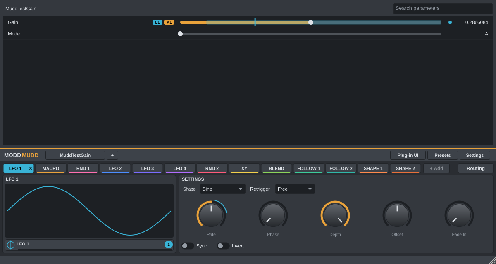

# ModdMudd

A universal modulation VST3 plugin for macOS, Linux and Windows. Insert ModdMudd in your DAW, load a third-party VST3 instrument or effect inside it, and modulate that plugin's parameters with LFOs, randomizers, macros, an XY pad, a four-state preset blender and an envelope follower.

ModdMudd is an independent project, built with C++, JUCE 9 and CMake. It produces VST3 only: no AU, VST2, AAX or standalone builds.

## Status

Early development. Hosting, the modulation engine, the editor and state saving work, and are tested automatically on Linux, macOS and Windows. Nothing has been tested in a DAW yet.

| | |
|---|---|
| [docs/ARCHITECTURE.md](docs/ARCHITECTURE.md) | how it works and why |
| [docs/BUILDING.md](docs/BUILDING.md) | build on Linux and macOS |
| [docs/LIMITATIONS.md](docs/LIMITATIONS.md) | known limitations |
| [docs/COMPATIBILITY.md](docs/COMPATIBILITY.md) | what has actually been tested |

## Features

- The modulation panel snaps under the hosted plug-in at the plug-in's own width, so the two read as one window. Resizable plug-ins follow the window.
- Hosts up to four VST3 plug-ins in series (an instrument plus effects in the Instrument build).
- **Build your own modulation chain:** add only the modulators you want, drag to reorder, remove with one click. Choose from 4 LFOs (including custom drawn shapes), 2 randomizers, 8 macros, an XY pad, 2 envelope followers, 2 drawn envelope generators ("Shapers", triggered by notes, audio transients or the transport), and a four-state preset blender.
- **Cross-modulation**, where modulators drive each other. Loops are refused.
- **Assigning modulation:**
  - drag a source onto a parameter
  - click a source, then move a control in the hosted plug-in's own window
  - use the Routing view
- The preset blender can capture snapshots straight from a hosted plug-in's own presets, then morph between them.
- Every modulator has its own colour. Modulated parameters show coloured tags for their sources, and the range the modulation can reach.
- Each source shows how many targets it has. Click the number to adjust depths or remove targets in place.
- Modulation resolution is per 32-sample sub-block by default, rather than per host buffer.
- 256 DAW-automatable slots, named after the hosted parameters. MIDI learn on every ModdMudd control.
- Sessions and presets find hosted plug-ins by VST3 class ID, so they move between machines. Plug-ins that aren't installed are kept, not lost.

## Builds

| Target | VST3 type | Hosts |
|---|---|---|
| ModdMudd FX | Audio effect | VST3 effects |
| ModdMudd Instrument | Instrument | A VST3 instrument, optionally followed by effects |

## Platform notes

- Logic Pro and GarageBand do not load VST3 plugins, so they cannot run ModdMudd.
- Pro Tools requires AAX, which ModdMudd does not build.
